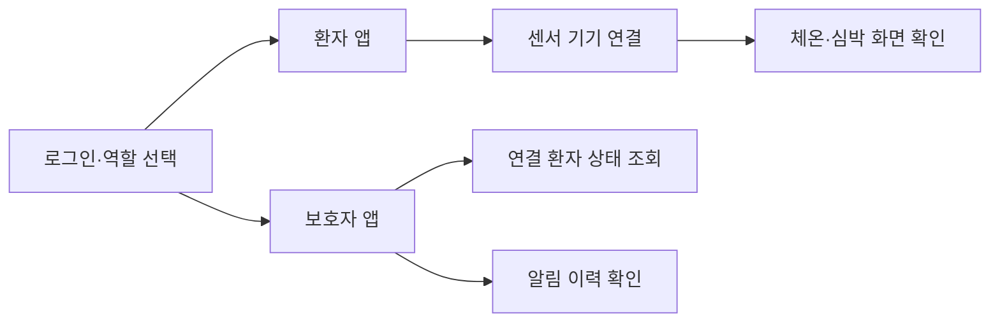
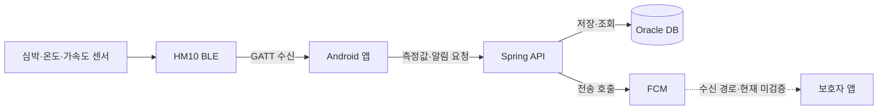
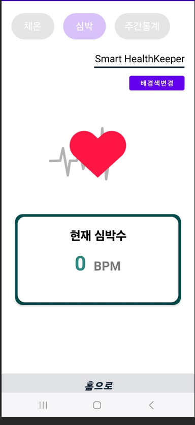

# HealthKeeper | Android·IoT 건강 모니터링

환자의 심박·체온·낙상 관련 데이터를 수집하고 보호자가 상태를 확인하도록 기획한 **Android·IoT·Spring 팀 프로젝트**입니다. 센서 장치와 모바일 앱, 서버·DB 사이의 데이터 전달 구조를 중심으로 소개합니다.

> 아래 내용은 저장소 코드와 당시 발표자료를 근거로 정리했습니다. 현재 운영 여부와 실행 환경은 확인하지 않았으며, 기기 연결·서버 실행·알림 수신 성공을 보장하지 않습니다.

## 프로젝트 한눈에 보기

| 구분 | 내용 |
| --- | --- |
| 사용자·목표 | 환자 상태 확인, 보호자 연결 및 이상 상태 알림 |
| Android | Java, Android SDK 34 설정, Bluetooth GATT, ViewModel·LiveData, Retrofit, MPAndroidChart |
| 서버·데이터 | Java 11·Spring MVC 5.3.25 설정, MyBatis, Oracle, Firebase Cloud Messaging |
| IoT | Arduino 센서 코드, MLX90614 온도·심박·ADXL345 가속도 센서, HM10 Bluetooth 모듈 설계 |
| 함께 구성한 화면 | 회원가입·로그인, 환자·보호자 연결, 상태 조회, 커뮤니티, CCTV |

기술 목록은 [Android 설정](App/app/build.gradle), [Spring 설정](Spring/healthkeeper/pom.xml), [센서 코드](iot/project/project.ino), [발표자료](자료/health.pptx)에서 확인할 수 있습니다. 의존성 선언이나 화면·코드가 남아 있다는 사실과 현재 동작 검증은 구분합니다.

## 사용자 흐름

환자와 보호자의 화면 이용 흐름입니다. [발표자료의 로그인·회원가입·앱 화면](자료/health.pptx), [심박 화면의 환자·보호자 분기](App/app/src/main/java/com/example/healthkeeper/main/monitor/HeartRateFragment.java), [알림 이력 조회](App/app/src/main/java/com/example/healthkeeper/main/PushActivity.java)를 바탕으로 역할별 경로를 나눴습니다. 환자·보호자 연결과 기기·서버 설정이 필요한 흐름이며, 현재 실행을 재현한 결과는 아닙니다.

## 데이터 전달 구조

아래 화살표는 코드에 남은 데이터 전달 경계입니다. 위 사용자 흐름과 구분하며, 실제 통신 성공이나 배포 구성을 보증하지 않습니다.

센서·GATT·저장·알림 호출의 근거는 아래 **주요 흐름과 구현 근거**에 연결했습니다. Spring 내부의 Controller·Service·MyBatis 계층은 한 노드로 묶었습니다. 이상 상태 처리 분기와 FCM 호출 코드가 있다는 뜻이지, 의료적 진단이나 알림 도착을 입증하는 그림은 아닙니다.

## 당시 앱 화면

**당시 발표자료 화면, 현재 실행 검증 아님.** [발표자료 29번 슬라이드](자료/health.pptx)의 내장 이미지 `ppt/media/image92.png`를 변형 없이 공개용으로 복사했습니다. 화면은 `0 BPM` 표시 상태로, 실제 측정값 수신이나 측정 정확도를 입증하지 않습니다. 이미지 전체를 직접 확인했으며 이름·계정·기기 ID·주소·서버 주소·로그인 정보가 보이지 않는 화면을 골랐습니다.

## 주요 흐름과 구현 근거

1. **장치 → Android:** 센서 코드에 `hr,65,tp,36.3,ac,0` 형식의 전송 예시가 있습니다. [BluetoothConnector](App/app/src/main/java/com/example/healthkeeper/bluetooth/BluetoothConnector.java)는 GATT 특성 값을 UTF-8 문자열로 읽고 `hr`·`tp`·`ac`를 심박·체온·낙상 관련 값으로 매핑하는 구조입니다.
2. **Android 내부 상태 전달:** 수신 값은 `ConditionVO`와 ViewModel 상태로 나뉩니다. [BluetoothService](App/app/src/main/java/com/example/healthkeeper/bluetooth/BluetoothService.java)에 연결 관리와 상태 관찰·이상 상태 분기 코드가 남아 있습니다.
3. **Android → Spring → DB:** [BluetoothRepository](App/app/src/main/java/com/example/healthkeeper/bluetooth/BluetoothRepository.java)의 `insertCondition` 요청, [AndMemberController](Spring/healthkeeper/src/main/java/kr/co/and/AndMemberController.java)의 수신 처리, [MyBatis 매퍼](Spring/healthkeeper/src/main/resources/kr/co/mapper/AndMemberMapper.xml)의 `CONDITIONS` 저장 구문으로 이어지는 경계를 확인할 수 있습니다.
4. **보호자 알림:** [FirebaseController](Spring/healthkeeper/src/main/java/kr/co/and/FirebaseController.java)는 보호자 정보 조회, 알림 이력 저장, FCM 전송 호출을 묶습니다. 이는 코드상 처리 흐름이며 실제 단말 수신 성공의 증거는 아닙니다.

## 기록으로 확인되는 담당 범위

**발표자료에 기록된 담당: 김민주 — 프로젝트 총괄, DB 설계·수정, IoT 기기 설계, Android Bluetooth 관련 처리.**

근거는 [발표자료 4번 슬라이드의 역할표](자료/health.pptx)입니다. 위 항목은 당시 역할 기록이며 각 파일 전체의 단독 작성이나 모든 기능의 개인 구현을 뜻하지 않습니다. 회원가입·소셜 로그인·앱 주요 화면·웹 기능 등은 팀 전체 결과와 구분하며, 이 README의 주요 흐름도 팀 프로젝트 기준입니다.

## 코드에서 읽을 수 있는 설계 판단

당시 의사결정 회의록이 아니라, 남아 있는 구조를 바탕으로 설명한 판단과 제약입니다.

| 구조·선택 | 설명과 제약 | 근거 |
| --- | --- | --- |
| 센서 전송 형식과 앱 데이터 모델 분리 | `hr`·`tp`·`ac`를 앱 상태와 `ConditionVO`로 변환하는 경계가 있습니다. 센서 표현을 화면·저장 모델과 나눌 수 있지만, 잘못된 패킷이나 범위 밖 값을 어떻게 다룰지는 별도 검증이 필요합니다. | [BluetoothConnector](App/app/src/main/java/com/example/healthkeeper/bluetooth/BluetoothConnector.java) |
| 연결 처리와 화면 상태 분리 | Service·Connector·Repository·ViewModel로 역할을 나눈 구조입니다. 화면과 연결·저장 작업을 구분하지만, 연결 해제·재연결·생명주기에서 안정적으로 이어지는지는 현재 확인하지 않았습니다. | [Bluetooth 코드](App/app/src/main/java/com/example/healthkeeper/bluetooth) |
| 앱 요청과 SQL 사이 서버 계층 배치 | Android 요청을 Controller·Service·MyBatis 경유로 처리합니다. 저장과 보호자 조회·알림 이력 처리를 서버에 두었지만, 저장·FCM 전송의 부분 실패를 포함한 일관성은 검증되지 않았습니다. | [Android용 Controller](Spring/healthkeeper/src/main/java/kr/co/and), [Service](Spring/healthkeeper/src/main/java/kr/co/service/AndMemberServiceImpl.java), [매퍼](Spring/healthkeeper/src/main/resources/kr/co/mapper/AndMemberMapper.xml) |

## 결과와 한계

- **남아 있는 산출물:** Android 앱, Spring 웹·앱 연동 코드, 센서 코드, ERD·SQL, 웹 화면 및 Android 시연을 설명하는 발표자료입니다. 발표자료의 시연 구성은 당시 기록이며 이번 정리에서 재현한 실행 결과가 아닙니다.
- **현재 소스 상태:** Bluetooth·서버·센서 코드와 Android 의존성 선언 일부에 구문이 누락되거나 불완전한 부분이 있습니다. 현재 저장소를 그대로 빌드·실행할 수 있다고 안내하지 않습니다.
- **측정·알림 신뢰성:** 센서 정확도, 낙상 판별 정확도, 통신 지연, FCM 수신률과 장시간 동작 수치는 확인되지 않았습니다. 의료적 판단이나 상용 안전성을 입증한 프로젝트로 소개하지 않습니다.
- **재현 범위:** 장치, DB, 외부 API·Firebase 설정이 필요합니다. 서버 모듈이 두 곳에 남아 있으며 두 모듈의 배포 관계·최종 사용 버전은 문서로 확정하지 못했습니다. 이번 작업에서는 설치·빌드·테스트·기기 연결을 수행하지 않았습니다.

## 코드·자료 찾아보기

| 경로 | 읽을 내용 |
| --- | --- |
| [App](App) | Android 화면, Bluetooth 연결·데이터 처리, 서버 통신 |
| [Spring/healthkeeper](Spring/healthkeeper) | Spring MVC 웹 화면, Android 연동 API, MyBatis 매퍼, FCM |
| [mid](mid) | 별도 Spring 서버 모듈의 회원·커뮤니티·Firebase 처리 코드 |
| [iot](iot) | 센서·Bluetooth 전송 코드와 카메라 관련 코드 |
| [발표자료](자료/health.pptx) · [시나리오](자료/시나리오.hwp) · [ERD](자료/erd.dmd) · [SQL](자료/sql) | 기획 배경, 역할표, 화면·장치 구성, 데이터 설계 자료 |

## 로컬 설정

아래는 기존 설정 안내입니다. 실행 성공을 확인한 절차는 아니며, 현재 소스 상태와 별개로 필요한 설정 위치를 보존합니다.

실제 키와 비밀번호는 Git에 추가하지 않습니다. 예전 저장소에 있던 값은 재사용하지 말고 새로 발급한 값을 사용하세요.

- [info.properties.example](info.properties.example)을 사용할 서버 모듈의 `src/main/resources/info.properties`로 복사하고 카카오·네이버·메일 설정을 입력합니다.
- Firebase 메시지를 사용하려면 새 서비스 계정 키를 해당 서버 모듈의 `src/main/resources/serviceAccountKey.json`에 둡니다. 현재 코드는 classpath 경로를 읽습니다. 파일이 포함된 서버 빌드 결과물도 공개하면 안 됩니다.
- `Spring/healthkeeper`는 실행 환경의 `DB_URL`, `DB_USER`, `DB_PASSWORD`로 DB에 접속합니다. `DB_URL`은 `jdbc:log4jdbc:oracle:thin:@localhost:1521:xe` 같은 log4jdbc URL입니다. JDBC 연결 테스트도 같은 환경변수를 사용합니다.
- `mid`는 [db.properties.example](mid/src/main/resources/dbconn/db.properties.example)을 같은 디렉터리의 `db.properties`로 복사하고 DB 연결 정보를 입력합니다.
- Android Firebase 설정 파일 `google-services.json`은 `App/app/`에 둡니다.

기존 안내에는 **2026-09-19에 원격 5개 브랜치의 과거 이력에서 비밀 파일·하드코딩 자격증명·기기 토큰을 제거했다는 기록**이 있습니다. 이는 과거 작업 기록이며 이번 README 정리에서 재검증하지 않았습니다. 기존 복제본을 다시 푸시하면 이전 이력이 복구될 수 있으므로 새로 clone해서 사용하세요. GitHub의 옛 커밋 캐시나 다른 사람이 가진 사본의 삭제까지 보장하는 작업은 아닙니다.
